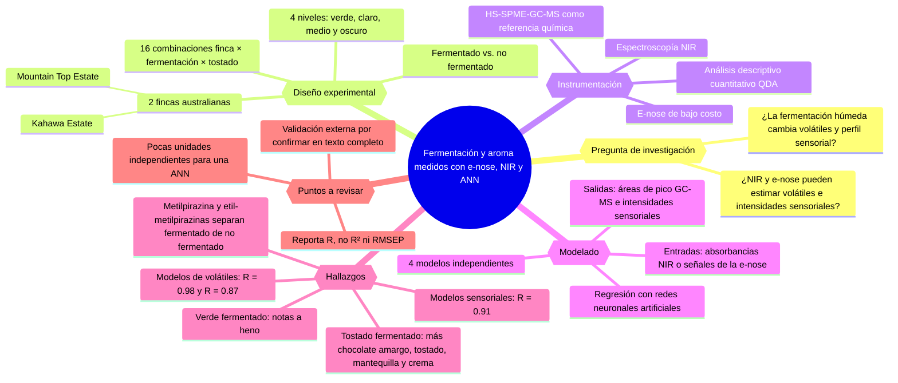
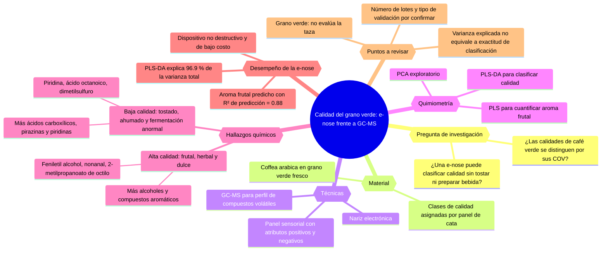
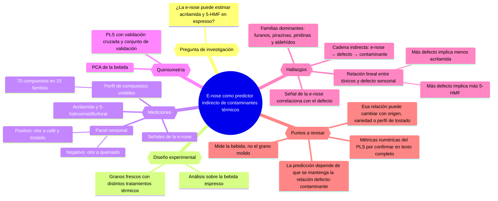
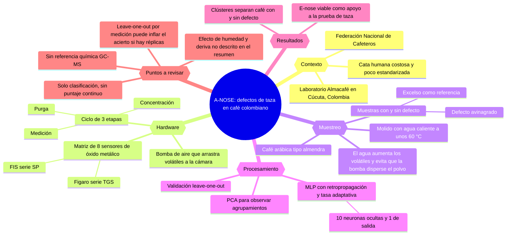
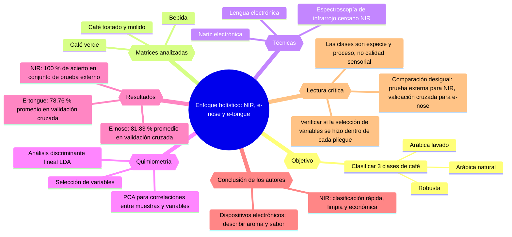
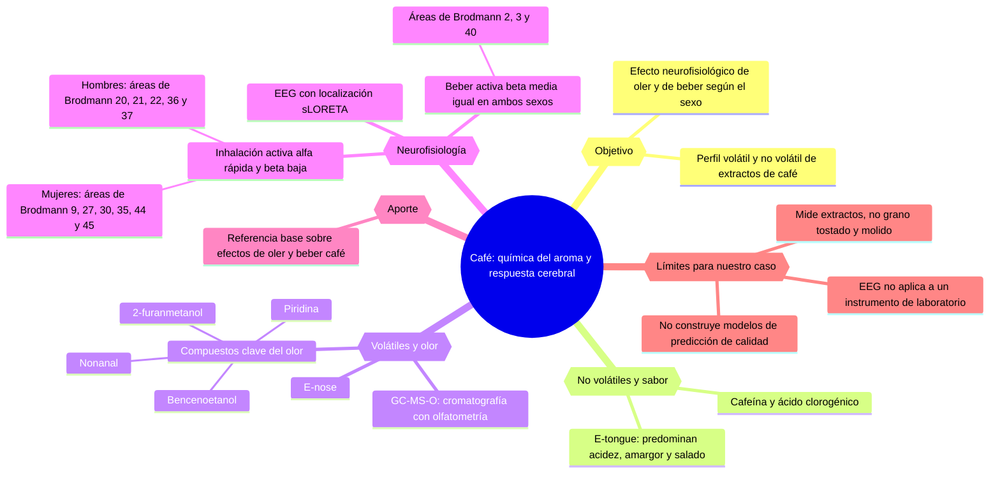

## Relevancia máxima
 1. Evaluation of spontaneous fermentation impact on the physicochemical properties and sensory profile of green and roasted arabica coffee by digital technologies

## Relevancia muy alta
5. Electronic Nose and Gas Chromatograph Devices for the Evaluation of the Sensory Quality of Green Coffee Beans

## Relevancia alta
9. Electronic Prediction of Chemical Contaminants in Aroma of Brewed Roasted Coffee and Quantification of Acrylamide Levels

13. Electronic nose for quality control of Colombian coffee through the detection of defects in "Cup Tests"

## Relevancia media
17. Discrimination between washed Arabica, natural Arabica and Robusta coffees by using near infrared spectroscopy, electronic nose and electronic tongue analysis

## Relevancia baja
21. Investigation of non-volatile and volatile compound profiles in Arabica coffee extracts and neurophysiological effects of different chemosensory stimulation according to sex: Insights from electronic sensors, EEG, and sLORETA approaches

