## Relevancia máxima
 1. Evaluation of spontaneous fermentation impact on the physicochemical properties and sensory profile of green and roasted arabica coffee by digital technologies

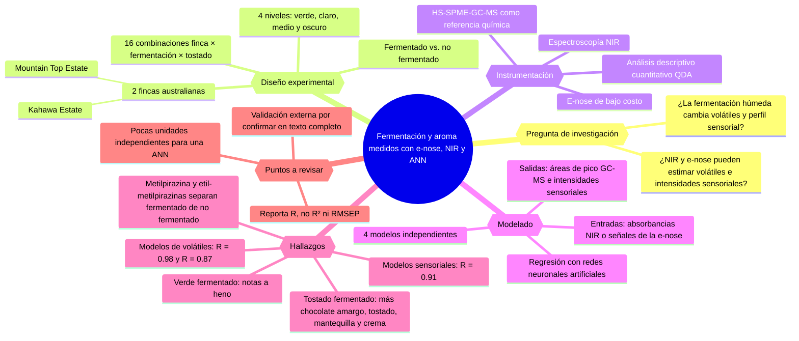
4\. **Detection and Differentiation of Volatile Compound Profiles in Roasted Coffee Arabica Beans from Different Countries Using an Electronic Nose and GC-MS**

Gancarz y colaboradores (2020) compararon cafés arábica de Brasil, Etiopía, Guatemala, Costa Rica y Perú, tostados bajo las mismas condiciones. Contrastaron las respuestas de los ocho sensores de la Agrinose con los perfiles de volátiles obtenidos por GC-MS. El análisis de componentes principales separó especialmente la muestra brasileña de las de Etiopía, Guatemala y Costa Rica. La cromatografía encontró niveles elevados de piridina en Brasil y Perú. Para FONFIVE, el estudio aporta un ejemplo de cómo contrastar la huella de la nariz electrónica con una referencia química independiente. [Artículo original](https://doi.org/10.3390/s20072124)

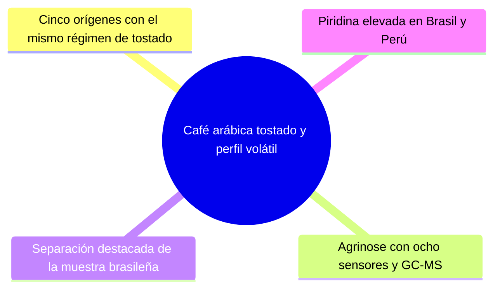

## Relevancia muy alta
5. Electronic Nose and Gas Chromatograph Devices for the Evaluation of the Sensory Quality of Green Coffee Beans

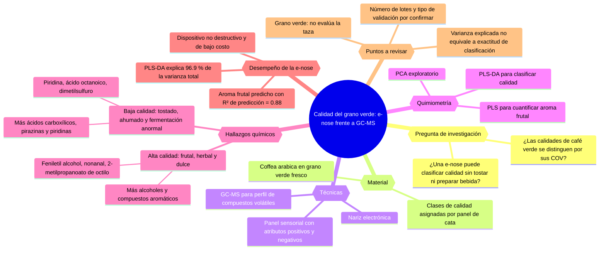

8\. **Effectiveness of an E-Nose Based on Metal Oxide Semiconductor Sensors for Coffee Quality Assessment**

Mutz y colaboradores (2025) construyeron una nariz electrónica con 12 sensores MOS, una cámara de medición y un Arduino Mega. Evaluaron la clasificación por especie, grado de tostado y caducidad. El modelo LS-SVM clasificó correctamente todas las muestras de prueba en las tres tareas. Los cafés caducados llevaban alrededor de dos años fuera de fecha, por lo que ese resultado corresponde a grupos con una diferencia marcada. El montaje sirve como referencia para integrar los sensores, la cámara y la adquisición de señales de FONFIVE. [Artículo original](https://doi.org/10.3390/chemosensors13010023)

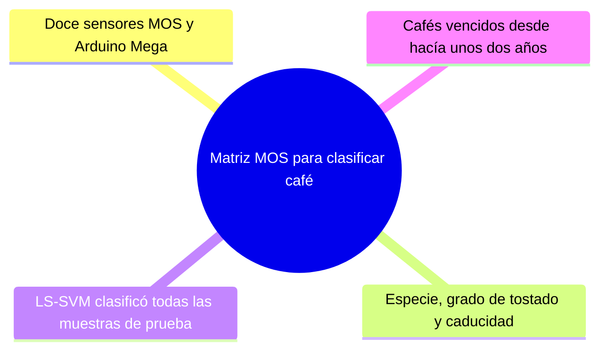

## Relevancia alta
9. Electronic Prediction of Chemical Contaminants in Aroma of Brewed Roasted Coffee and Quantification of Acrylamide Levels

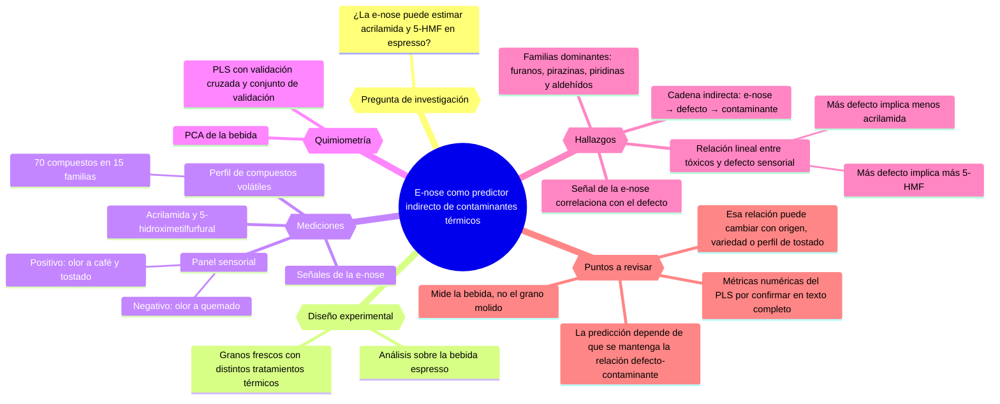

12\. **Accelerated storage of ground coffee: Merging of analytical techniques to assess sensitivity to oxygen and moisture exposure**

De Agostini y colaboradores (2026) almacenaron un lote de arábica molido de tueste claro en envases abiertos hasta 42 días, bajo distintas condiciones de temperatura y humedad. Compararon la nariz electrónica, HS-SPME-GC-MS y espectroscopía FT-NIR con la evaluación sensorial. El panel registró menor intensidad aromática, cuerpo y persistencia del sabor, junto con más notas oxidativas. Estos cambios coincidieron con variaciones de las señales y con la pérdida de volátiles asociados al aroma fresco. El estudio ilustra cómo relacionar las mediciones de FONFIVE con cambios perceptibles en taza. [Artículo original](https://doi.org/10.1016/j.foodres.2025.118025)

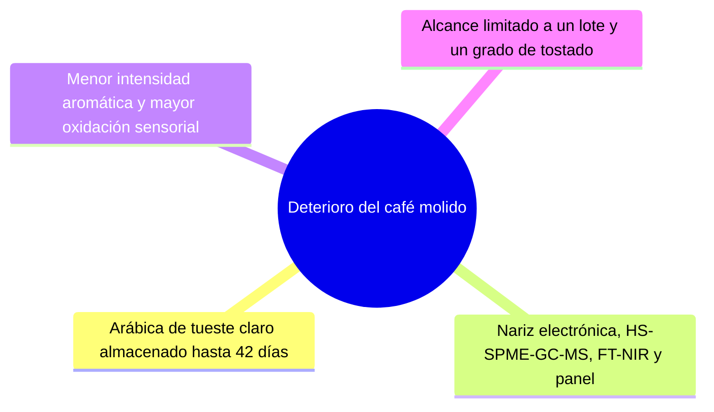

13. Electronic nose for quality control of Colombian coffee through the detection of defects in "Cup Tests"

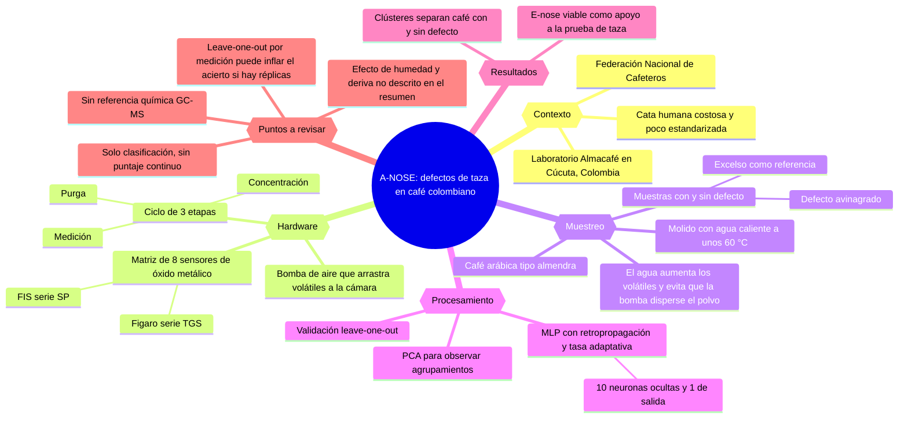

## Relevancia media alta
16\. **Differentiation of Chinese robusta coffees according to species, using a combined electronic nose and tongue, with the aid of chemometrics**

Dong y colaboradores (2017) analizaron 126 muestras tostadas de siete cultivares de robusta de Hainan, China. Combinaron una nariz electrónica y una lengua electrónica para diferenciar cultivares y estimar el pH, la acidez titulable y el contenido de sólidos, entre otras propiedades. La regresión por mínimos cuadrados parciales (PLSR) con datos de ambos instrumentos ofreció el mejor desempeño para estimar esos parámetros en el estudio. Para FONFIVE, es un ejemplo de calibración con mediciones de referencia y fusión de señales. La síntesis se basa en el resumen original y los extractos editoriales disponibles. [Resumen original](https://pubmed.ncbi.nlm.nih.gov/28372239/)

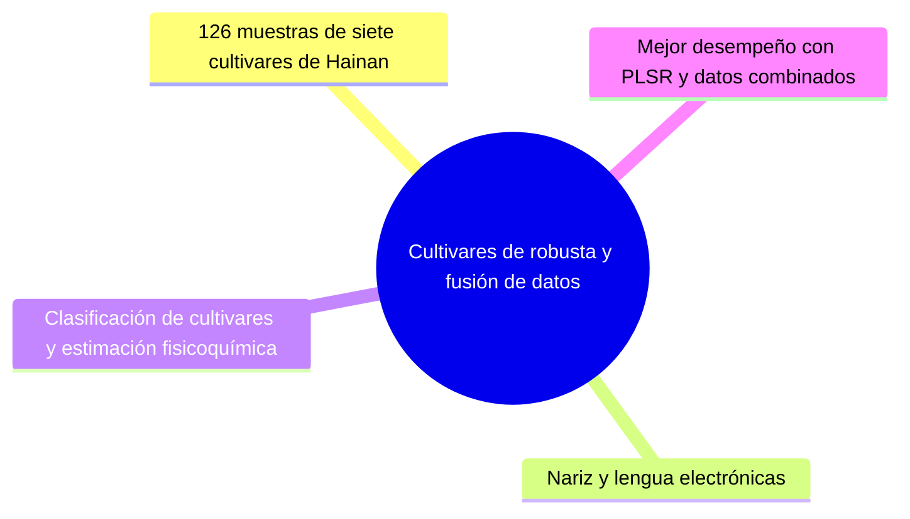

## Relevancia media
17. Discrimination between washed Arabica, natural Arabica and Robusta coffees by using near infrared spectroscopy, electronic nose and electronic tongue analysis

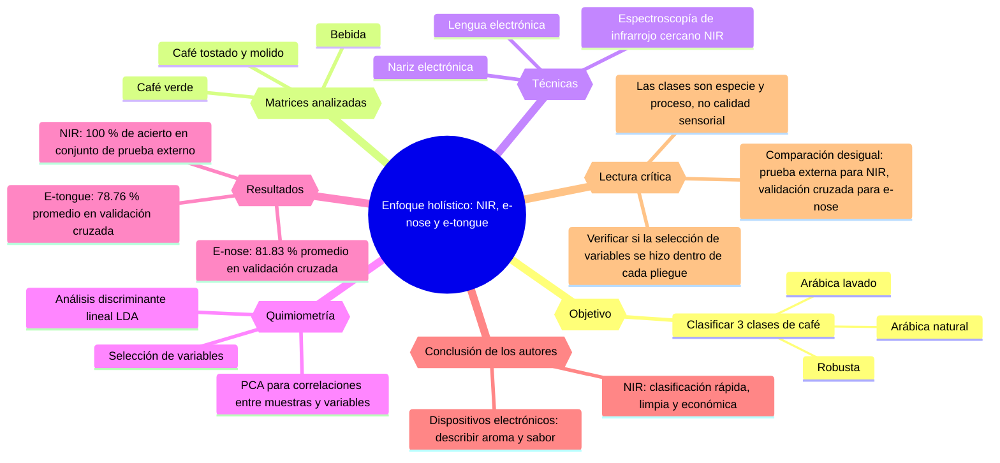

## Relevancia media baja
20\. **A novel electronic nose as adaptable device to judge microbiological quality and safety in foodstuff**

Sberveglieri y colaboradores (2014) evaluaron una nariz electrónica con sensores de óxido metálico de película delgada y nanohilos. En el caso de café verde, el análisis de componentes principales distinguió cambios asociados al crecimiento de mohos desde el tercer día. El arreglo de película delgada descrito en el trabajo previo los distinguía desde el sexto. Los análisis microbiológicos y cromatográficos complementaron la interpretación. Su aporte a FONFIVE se concentra en el diseño de la matriz de sensores para detectar cambios del perfil volátil. [Artículo original](https://doi.org/10.1155/2014/529519)

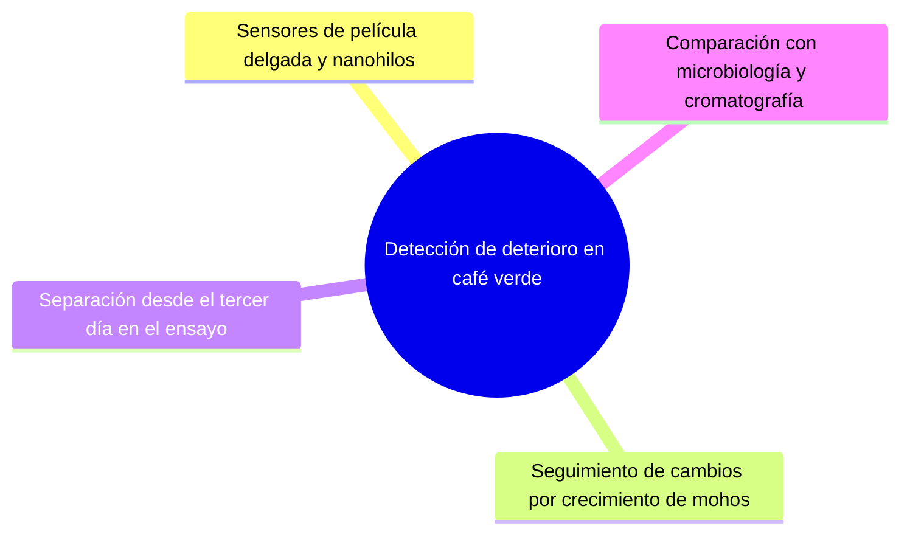

## Relevancia baja
21. Investigation of non-volatile and volatile compound profiles in Arabica coffee extracts and neurophysiological effects of different chemosensory stimulation according to sex: Insights from electronic sensors, EEG, and sLORETA approaches

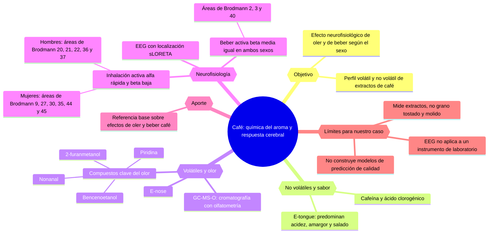
