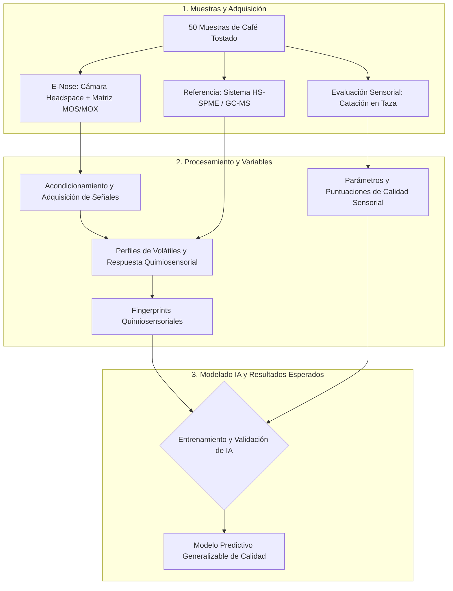

## Representación conceptual

## Elementos, etapas o componentes principales
* **Instrumento E-Nose (Hardware):** Diseño e integración que incluye sistema de presentación controlada del espacio de cabeza (headspace), matriz de sensores MOS/MOX, y electrónica de acondicionamiento/adquisición de señales.
* **Instrumentos de Referencia:** Sistema de cromatografía de gases acoplado a espectrometría de masas (HS-SPME/GC-MS).
* **Evaluación sensorial:** Catación estandarizada realizada por catadores especializados para determinar los parámetros de calidad de la bebida preparada.
* **Modelado de IA:** Empleo de inteligencia artificial para vincular la información instrumental obtenida con las puntuaciones sensoriales.

## Entradas, datos, variables, muestras o información requerida
* **Muestras:** 50 muestras independientes de café tostado.
* **Variables Instrumentales:** Perfiles químicos de compuestos volátiles y patrones de respuesta quimiosensorial extraídos directamente del café tostado.
* **Variables Sensoriales:** Parámetros de calidad determinados mediante la evaluación en taza.

## Resultados, salidas o productos esperados
* **Fingerprints Quimiosensoriales:** Generación de huellas digitales que contengan información químicamente sustentada para representar la calidad sensorial del café.
* **Modelo Predictivo Generalizable:** Un modelo de inteligencia artificial capaz de predecir parámetros de calidad sensorial en bebidas de cafés desconocidos o muestras independientes, a partir de los datos de la E-nose.
