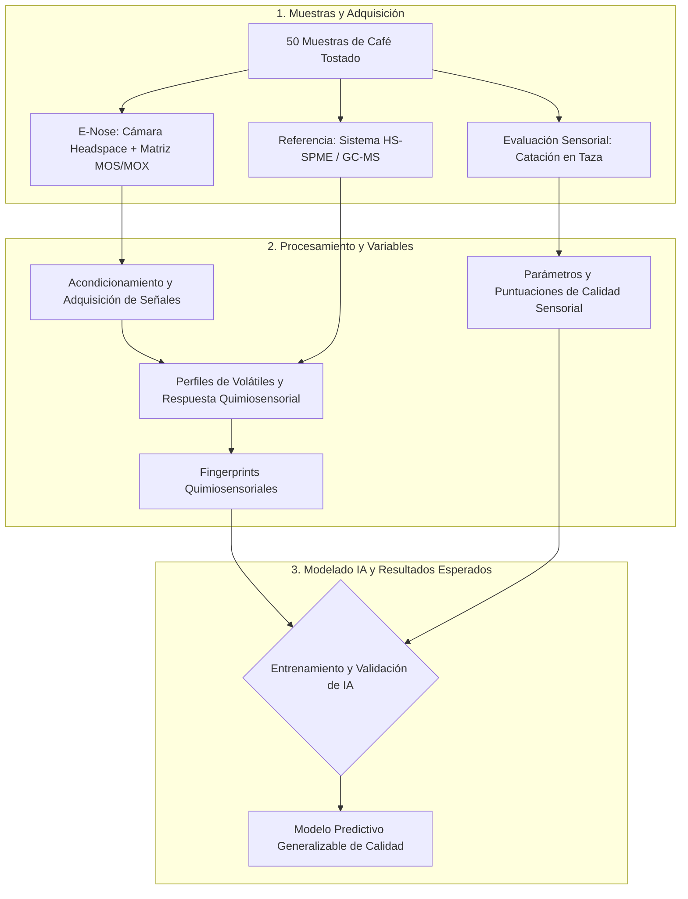

## OBJETIVO PRELIMINAR
Desarrollar una E-nose asistida por inteligencia artificial para predecir parámetros de calidad 
sensorial del café mediante fingerprints quimiosensoriales del café tostado sustentados en sus 
perfiles químicos de compuestos volátiles.

## EXPLICACIÓN DE SU RELACIÓN CON EL PROBLEMA O PREGUNTA

## DESCRIPCIÓN GENERAL DE LA PROPUESTA
La E-Nose a desarrollar contará con una headspace donde se pondrá la muestra de café tostado, en ese espacio la muestra se someterá a cierta temperatura para que libere componentes volátiles...
## DIAGRAMA CONCEPTUAL O ESQUEMA METODOLÓGICO

## LÍMITES PRELIMINARES
A favor de establecer un marco de referencia realista, a continuación, se presentan las limitaciones del proyecto a llevar a cabo:

- **Principio de detección no individual:**
La matriz de sensores MOS/MOX, opera bajo un algoritmo llamado sensibilidad cruzada, es decir, no identifica moléculas específicas de forma aislada, sino, requiere de los fingerprints para procesar la información.

- **Indefinición de la temperatura óptima:**
Aún es necesario definir una temperatura de muestreo estandarizada o con un control térmico adaptativo para cada tipo de café. Esto es importante pues, la temperatura para liberar los compuestos volátiles sin degradar la muestra varía según las especificaciones del grano.

- **Tiempos prologados de purga:**
La alta concentración de compuestos orgánicos volátiles del café tostado puede saturar superficialmente los sensores MOS, derivando en tiempos de recuperación largos entre pruebas.

- **Entorno operativo:**
El prototipo opera en condiciones controladas, con fuentes externas de aire cero, por lo tanto, no está pensado para operar en atmósferas externas no purificadas ni en entornos no asistidos.

## PRODUCTOS O RESULTADOS ESPERADOS
* Establecimiento de la relación entre la composición volátil y los fingerprints quimiosensoriales
   del café tostado.
* Identificación de las relaciones entre la información química y quimiosensorial del café tostado
   y sus características sensoriales en taza.
* Desarrollo de modelos predictivos de parámetros de calidad sensorial a partir de los fingerprints
   quimiosensoriales.
* Validación de la capacidad predictiva de la E-nose frente a muestras independientes.
* Generación de un modelo integrador entre composición volátil, fingerprint quimiosensorial y
   calidad sensorial.
* Establecimiento de bases científicas y tecnológicas para una plataforma de evaluación rápida del
   café tostado.
* Dos artículos científicos derivados de los principales resultados del proyecto, que serán
   sometidos a revistas internacionales arbitradas e indexadas en el Journal Citation Reports (JCR).
* Un artículo de divulgación científica.
* Una ponencia en un congreso científico, en la que se presentarán resultados derivados del
   desarrollo y validación de la E-nose y/o de la integración de la información química,
   quimiosensorial y sensorial.
* Una conferencia dirigida a público no especializado, orientada a divulgar la importancia de la
   química del aroma, el análisis sensorial y las nuevas tecnologías basadas en sensores e
   inteligencia artificial para el estudio y evaluación de la calidad del café.
* Una tesis de licenciatura, desarrollada en el marco del proyecto y vinculada con alguno de sus
   componentes experimentales, analíticos o tecnológicos.

## ASPECTOS PENDIENTES DE DEFINICIÓN

La propuesta es preliminar. Los siguientes aspectos deberán acordarse con el equipo de Ingeniería, el equipo de Química y quienes participen en la evaluación sensorial antes de establecer el diseño definitivo. Las 50 muestras y los componentes mencionados en este documento son parte de la planeación; su inclusión no demuestra que ya estén disponibles o implementados.

| Aspecto | Definición pendiente | Importancia para la viabilidad |
| --- | --- | --- |
| Alcance del prototipo | Precisar qué se entregará durante la materia: diseño conceptual, subsistemas probados, instrumento integrado o modelo validado; distinguirlo de los productos científicos del proyecto completo. | Permite ajustar los compromisos al tiempo, recursos y responsabilidades del equipo. |
| Variable que se predecirá | Acordar los atributos sensoriales, sus escalas y el protocolo de catación; aclarar si se estimarán puntuaciones continuas o categorías y cómo se construirán estas últimas. | Define la salida verificable del sistema y las referencias necesarias para evaluarla. |
| Muestras y trazabilidad | Confirmar disponibilidad, procedencia, lotes, cantidad de café, conservación, molienda y número de réplicas. Establecer un identificador común para relacionar las mediciones químicas, electrónicas y sensoriales de cada café. | Evita comparar datos que no correspondan a la misma muestra y permite organizar las 50 muestras previstas. |
| Selección de sensores | Determinar modelos, cantidad y configuración de sensores MOS/MOX con base en documentación técnica, disponibilidad y pruebas de respuesta a las mezclas de interés. | La afinidad química esperada no garantiza sensibilidad suficiente ni selectividad frente a los compuestos del café. |
| Condiciones de muestreo | Definir masa de muestra, volumen y material de la cámara, temperatura, tiempo de equilibrio, caudal y secuencia de línea basal, exposición y recuperación. | Permite obtener mediciones comparables sin dejar estas condiciones a criterio de cada operador. |
| Aire de referencia y purga | Confirmar la fuente y disponibilidad de aire cero, el sistema de regulación de flujo y el criterio para considerar recuperada la línea basal. | Condiciona la operación del instrumento, el tiempo entre muestras y el control del arrastre de una medición a la siguiente. |
| Electrónica y adquisición | Seleccionar alimentación, acondicionamiento, conversión analógica-digital, plataforma de control, frecuencia de muestreo y comunicación con la computadora. | Permite estimar recursos y comprobar que las señales podrán registrarse con calidad suficiente. |
| Datos y software | Acordar el formato de almacenamiento, unidades, metadatos, registro de temperatura y humedad, respaldo y herramientas de visualización y análisis. MATLAB aparece como preferencia en la lluvia de ideas, pero no como plataforma definitiva. | Facilita integrar los datos de los distintos equipos y reproducir su procesamiento. |
| Referencias químicas y sensoriales | Confirmar acceso al laboratorio, calendario de HS-SPME/GC-MS, participación de catadores y condiciones de entrega de sus resultados. | El entrenamiento y la evaluación dependen de referencias externas a la E-nose. |
| Fingerprints y modelos | Definir las características que se extraerán de las señales y comparar los modelos previstos en el protocolo. Acordar el papel de los perfiles químicos durante el desarrollo y las entradas necesarias durante una predicción posterior. | Evita exigir GC-MS en cada uso del prototipo si la finalidad es predecir a partir de la E-nose. |
| Validación y aceptación | Concretar la partición de muestras, el número de réplicas, las pruebas entre días y los límites admisibles de ruido, deriva, repetibilidad, respuesta, recuperación y error predictivo. | Permite evaluar el objetivo con criterios acordados antes de interpretar los resultados. Las réplicas de una muestra deberán permanecer agrupadas en las particiones, como establece el protocolo. |
| Recursos y responsabilidades | Confirmar inventario, costos, acceso a instalaciones, calendario y responsables de construcción, operación, análisis y mantenimiento. Revisar las condiciones de manejo de reactivos con el laboratorio. | Permite distinguir recursos disponibles, restricciones y supuestos pendientes de confirmación. |

## ACTORES, SISTEMAS Y ELEMENTOS EXTERNOS

Para delimitar el sistema, se considera como núcleo del prototipo la cámara de muestreo, la matriz MOS/MOX, la electrónica de adquisición y el software de control, registro y predicción. El siguiente cuadro identifica a quienes interactúan con ese núcleo y a los recursos externos necesarios para desarrollarlo o evaluarlo. Las funciones descritas son conceptuales; los responsables individuales y su disponibilidad deberán confirmarse.

| Actor, sistema o elemento | Relación con la E-nose | Intercambio o participación prevista | Base documental y estado |
| --- | --- | --- | --- |
| Equipo de Ingeniería en Automatización | Desarrollador e integrador del prototipo. | Diseño e integración del muestreo, sensores, electrónica, control y adquisición; documentación de pruebas y coordinación de interfaces con los otros equipos. | Participación descrita en U2.1 y en la lluvia de ideas. Distribución técnica detallada por confirmar. |
| Equipo de Química y laboratorio | Proporciona la referencia química y apoyo para interpretar los volátiles. | Perfiles HS-SPME/GC-MS asociados con los identificadores de las muestras y explicación de los compuestos relevantes. | Función planteada en U2.1 y en el protocolo. Calendario y formato de entrega por confirmar. |
| Catadores especializados | Proporcionan la referencia sensorial para entrenar y evaluar los modelos. | Evaluación de las bebidas y entrega de puntuaciones por atributo y muestra; el protocolo contempla una evaluación codificada y ciega. | Participación prevista en U2.2 y en el protocolo. Integrantes y disponibilidad por confirmar. |
| Operador del prototipo | Usuario directo durante las mediciones de laboratorio. | Identifica y coloca la muestra, inicia el ciclo, consulta el estado del instrumento y obtiene el registro y, cuando exista un modelo validado, la predicción. | Rol necesario según el funcionamiento automatizado propuesto en la lluvia de ideas. Perfil y procedimiento por definir. |
| Docentes y responsables académicos del proyecto | Revisan el alcance, la coherencia y los entregables académicos. | Retroalimentación sobre la propuesta y los criterios de revisión; coordinación de necesidades con el equipo. | El issue #6 solicita discutir dudas y necesidades de información. Responsables de cada aprobación por confirmar. |
| Proveedores de muestras y posibles beneficiarios | Aportan o facilitan cafés y pueden utilizar los resultados en una aplicación futura. | Información de procedencia y procesamiento de los lotes; necesidades relacionadas con evaluación y control de calidad. | U2.1 identifica productores y cafetaleros como beneficiarios potenciales; no se confirma todavía un proveedor ni una adopción comercial. |
| Sistema HS-SPME/GC-MS | Instrumento externo de referencia, distinto de la matriz MOS/MOX. | Produce perfiles químicos para estudiar su relación con las respuestas de la E-nose. No se asume que forme parte del prototipo ni que se requiera en cada predicción posterior. | Referencia incluida en el diagrama y en el protocolo. Acceso operativo por confirmar. |
| Preparación de bebidas y catación | Proceso externo al instrumento electrónico. | Genera los valores sensoriales de referencia de los mismos cafés caracterizados instrumentalmente. | Etapa prevista en el protocolo; condiciones de ejecución por acordar. |
| Suministro eléctrico, aire cero y laboratorio | Recursos externos de operación. | Energía, aire de referencia y condiciones ambientales; el prototipo deberá controlar o registrar las variables relevantes según su diseño. | Aire cero, control térmico y monitoreo ambiental aparecen en U2.2. Disponibilidad y especificaciones por confirmar. |
| Computadora y entorno de análisis | Plataforma de ejecución y apoyo al desarrollo. | Visualización, almacenamiento, procesamiento de señales, entrenamiento y evaluación; la ubicación final de la inferencia en computadora o sistema embebido queda por definir. | Software de registro previsto en U2.2 y análisis computacional en la lluvia de ideas y el protocolo. |

La catación y el análisis químico aportan referencias diferentes: la primera proporciona los atributos sensoriales que se pretende predecir y el segundo ayuda a interpretar el contenido químico de los fingerprints. Por ello, los perfiles químicos, las señales de sensores y las puntuaciones sensoriales deberán conservarse como conjuntos de datos distinguibles, relacionados mediante la identidad de cada muestra.

## INTEGRACIÓN DEL OBJETIVO Y DEL DIAGRAMA EN EL INFORME DE VIABILIDAD

Este documento reúne el apartado **U2.2. Objetivo y solución conceptual** que se propone incorporar al Informe de viabilidad. Para conservar una única versión del objetivo y del esquema, se toman como referencia el [objetivo preliminar](#objetivo-preliminar) y el [diagrama conceptual o esquema metodológico](#diagrama-conceptual-o-esquema-metodológico) incluidos al inicio. La integración al informe completo deberá conservar ambos elementos junto con su explicación, límites y pendientes.

El objetivo plantea desarrollar un instrumento que permita estudiar si los fingerprints del café tostado contienen información suficiente para predecir parámetros sensoriales de su bebida. El diagrama representa las tres rutas de caracterización de las mismas muestras: E-nose, HS-SPME/GC-MS y catación. Su convergencia permitirá relacionar las respuestas electrónicas con la composición volátil y las puntuaciones sensoriales, y evaluar posteriormente el desempeño con muestras que no hayan intervenido en el desarrollo del modelo.

El bloque del diagrama denominado **“Perfiles de Volátiles y Respuesta Quimiosensorial”** reúne conceptualmente información de dos instrumentos; no implica que sus datos sean idénticos. El fingerprint de la E-nose se obtendrá de las respuestas de su matriz de sensores. Los perfiles químicos se emplearán como referencia para interpretar esas respuestas y las puntuaciones de catación como referencia sensorial. Esta distinción deberá mantenerse al detallar el esquema y sus interfaces.

| Elemento del apartado U2.2 | Aportación al Informe de viabilidad | Comprobación o decisión posterior |
| --- | --- | --- |
| Objetivo preliminar | Define qué se propone desarrollar y para qué: predicción de parámetros sensoriales mediante fingerprints. | Acordar variables de salida y criterios cuantitativos de aceptación. |
| Diagrama conceptual | Expone muestras, instrumentos, adquisición, datos y modelado. | Precisar interfaces, distinguir entrenamiento de uso posterior y verificar los recursos necesarios para cada ruta. |
| Actores y sistemas externos | Identifica dependencias con laboratorio, catadores, operadores y proveedores de recursos. | Confirmar participación, disponibilidad y responsabilidades. |
| Límites y aspectos pendientes | Explicita las condiciones controladas y las decisiones abiertas. | Incorporar requisitos, alternativas, costos, riesgos y calendario durante el análisis de viabilidad. |

**Estado de integración:** el objetivo y el diagrama están contenidos y relacionados en este apartado U2.2. No se identificó un archivo independiente del Informe de viabilidad en la rama `main` revisada; por tanto, su incorporación a ese documento consolidado queda pendiente de que el equipo acuerde su ubicación y estructura. Tampoco se considera concluida la revisión por otro integrante solicitada en el issue #6.

### Fuentes internas de esta aportación

- [Issue #6: Objetivo y solución conceptual](https://github.com/adriana71/E-Nose-Cafe/issues/6) y [sub-issue #10: U2.2 Sebastián](https://github.com/adriana71/E-Nose-Cafe/issues/10).
- [U2.1: Problema, necesidad u oportunidad de investigación](https://github.com/adriana71/E-Nose-Cafe/blob/42a58346b287f19531af4af1c52a1db5b1f6302a/docs/U2/U2.1%20Problema%2C%20necesidad%20u%20oportunidad%20de%20investigaci%C3%B3n.md).
- [Lluvia de ideas](https://github.com/adriana71/E-Nose-Cafe/blob/42a58346b287f19531af4af1c52a1db5b1f6302a/docs/U2/Lluvia%20de%20ideas.md).
- [Protocolo FONFIVE 2026](https://github.com/adriana71/E-Nose-Cafe/blob/42a58346b287f19531af4af1c52a1db5b1f6302a/docs/evidencias/Protocolo%20FONFIVE%202026/F-50-01%20proyecto%20e-nose%20final%20ARM.docx), especialmente sus apartados de metodología, entrenamiento y validación.

----------------------------------------------------------------------------
# HASTA AQUÍ LO QUE SE HABÍA HECHO

# CONTEXTO Y CONDICIONES PRINCIPALES

## CONTEXTO DEL PROYECTO

El proyecto "Desarrollo de una E-nose asistida por inteligencia artificial para la predicción de la calidad sensorial del café a partir de fingerprints quimiosensoriales sustentados en perfiles de compuestos" nace de una iniciativa interdisciplinaria entre las Facultades de Ingenería y Química de la UAQ, se encuentra orientada a sustituir la subjetividad sensorial humana.

Consiste en predecir objetivamente atributos sensoriales del grano de café mediante un prototipo de nariz electrónica (E-Nose) y algoritmos de inteligencia artificial a partir de los compuestos volátiles desprendidos del café tostado.

## CONDICIONES PRINCIPALES

- **Muestras de estudio:** Se contemplarán 50 muestras independientes de café tostado representativas de diversos orígenes, procesos y tipo de tostado.
- **Acondicionamiento y muestreo de espacios de cabeza:** El sistema requiere una cámara hermética con control de temperatura. Además, el arrastre se compuestos volátiles se gestiona mediante un controlador de flujo másico (MFC).
- **Electrónica:** Deberá incorporar circuitos de alimentación, acondicionamiento de señales analógicas, así como monitoreo de temperatura y humedad de la cámara.
- **Control y registro de datos:** Se implementará un software para visualizar la información en tiempo real y almacenar de forma estructurada el flujo de datos obtenido.

## VERIFICACIÓN DEL OBJETIVO

El cumplimiento del objetivo podrá visualizarse a través de tres niveles cuantitativos:

- **Caracterización metrológica del hardware:**
Se deberá demostrar que el flujo de datos comprende una estabilidad en la línea basal, así como un bajo nivel de ruido electrónico y bajo flujo de aire cero.
Además, será necesario confirmar que los tiempos de respuesta y recuperación del sistema sean los adecuados. Por último, será necesario demostrar la correcta cuantificación de la deriva temporal en los sensores.

- **Validación química**
Se exhibirá el análisis de las 50 muestras mediante los métodos en fase sólida y cromatografía de gases acoplada a espectrometría de masas (HS-SPME/GC-MS) a favor de identificar los perfiles de compuestos volátiles reales.
Con esto, se deberá comprobar que las redes de correlación implementadas entre la matriz de sensores MOS/MOX y los compuestos químicos agrupe correctamente las muestras según su naturaleza química.

- **Capacidad predictiva de la inteligencia artificial**
Los resultados del modelo supervisado, producto de las redes neurales implementadas en la inteligencia artificial sean concordantes con las puntuaciones de catación estandarizada en la taza de café (aroma, sabor, acidez, cuerpo, balance y aceptación global).

## ELEMENTOS, ETAPAS O COMPONENTES PRINCIPALES
* **Instrumento E-Nose (Hardware):** Sistema instrumentado compuesto por una cámara de muestreo volátiles (headspace), una matriz de sensores quimiorresistivos (MOS/MOX) y circuitos de acondicionamiento y digitalización.
* **Instrumentos de Referencia:** Sistema de cromatografía de gases acoplado a espectrometría de masas (HS-SPME/GC-MS).
* **Evaluación sensorial:** Catación estandarizada realizada por catadores especializados para determinar los parámetros de calidad de la bebida preparada.
* **Modelado de IA:** Empleo de inteligencia artificial para vincular la información instrumental obtenida con las puntuaciones sensoriales.

## ENTRADAS, DATOS, VARIABLES, MUESTRAS O INFORMACIÓN REQUERIDA
* **Muestras:** 50 muestras independientes de café tostado.
* **Variables Instrumentales:** Perfiles químicos de compuestos volátiles y patrones de respuesta quimiosensorial extraídos directamente del café tostado.
* **Variables Sensoriales:** Parámetros de calidad determinados mediante la evaluación en taza.

## RESULTADOS, SALIDAS O PRODUCTOS ESPERADOS
* **Fingerprints Quimiosensoriales:** Generación de huellas digitales que contengan información químicamente sustentada para representar la calidad sensorial del café.
* **Modelo Predictivo Generalizable:** Un modelo de inteligencia artificial capaz de predecir parámetros de calidad sensorial en bebidas de cafés desconocidos o muestras independientes, a partir de los datos de la E-nose.
