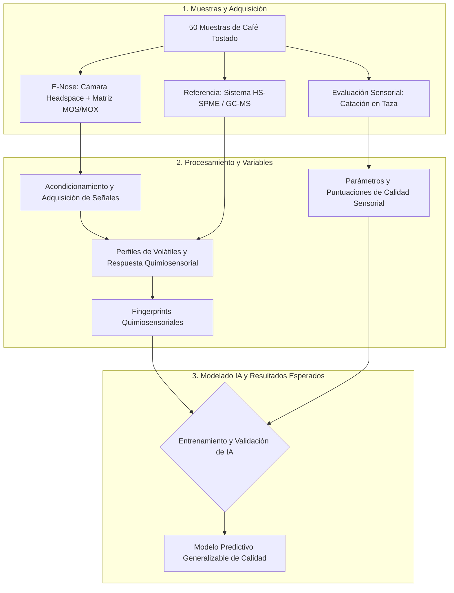

# OBJETIVO
Desarrollar una E-nose asistida por inteligencia artificial para predecir parámetros de calidad 
sensorial del café mediante fingerprints quimiosensoriales del café tostado sustentados en sus 
perfiles químicos de compuestos volátiles.

# POSIBLES PRODUCTOS E INVESTIACIONES (Aún en discusión)
* Generar la base de datos de los fingerprints quimicosensoriales.
* Dar a conocer y explicar al equipo de Automatización como funciona la HS-SPME/GC-MS tanto en la
  parte teórica como en la parte práctica, conociendo en persona la máquina que realiza este análisis.
* Dar una explicación química de los compuestos químicos relevantes encontrados con HS-SPME/GC-MS al
  equipo de Automatización para poder así conocer a detalle el fundamento del proyecto.\
* Sistema del espacio de cabeza (Head Space).
* Entender el funcionamiento de los sensores MOS/MOX.
* Crear la matriz de sensores MOS/MOX.
* Juntar el Head Space con la matriz de sensores para crear una E-NOSE.
* Calibrar la E-NOSE.
* Generar la base de datos a partir de la matriz de sensores de la E-NOSE.
* Entrenar una IA la cuál pueda generar fingerprints quimicosensoriales de las 50 muestras.
* Programa en computadora (preferentemente MATLAB) para poder crear una correlación entre los
  fingerprints y la calidad del café con apoyo de catadores certificados.
* Integración de los datos de la HS-SPME/GC-MS, la E-NOSE y los datos obtenidos de los catadores.
* Integración de todos los datos a la IA.

# RESULTADOS ESPERADOS
1. Establecimiento de la relación entre la composición volátil y los fingerprints quimiosensoriales
   del café tostado.
2. Identificación de las relaciones entre la información química y quimiosensorial del café tostado
   y sus características sensoriales en taza.
3. Desarrollo de modelos predictivos de parámetros de calidad sensorial a partir de los fingerprints
   quimiosensoriales.
4. Validación de la capacidad predictiva de la E-nose frente a muestras independientes.
5. Generación de un modelo integrador entre composición volátil, fingerprint quimiosensorial y
   calidad sensorial.
6. Establecimiento de bases científicas y tecnológicas para una plataforma de evaluación rápida del
   café tostado.

# PRODUCTOS DERIVADOS DEL PROYECTO
1. Dos artículos científicos derivados de los principales resultados del proyecto, que serán
   sometidos a revistas internacionales arbitradas e indexadas en el Journal Citation Reports (JCR).
2. Un artículo de divulgación científica.
3. Una ponencia en un congreso científico, en la que se presentarán resultados derivados del
   desarrollo y validación de la E-nose y/o de la integración de la información química,
   quimiosensorial y sensorial.
4. Una conferencia dirigida a público no especializado, orientada a divulgar la importancia de la
   química del aroma, el análisis sensorial y las nuevas tecnologías basadas en sensores e
   inteligencia artificial para el estudio y evaluación de la calidad del café.
5. Una tesis de licenciatura, desarrollada en el marco del proyecto y vinculada con alguno de sus
   componentes experimentales, analíticos o tecnológicos.

# CONTEXTO Y CONDICIONES PRINCIPALES

## CONTEXTO DEL PROYECTO

El proyecto "Desarrollo de una E-nose asistida por inteligencia artificial para la predicción de la calidad sensorial del café a partir de fingerprints quimiosensoriales sustentados en perfiles de compuestos" nace de una iniciativa interdisciplinaria entre las Facultades de Ingenería y Química de la UAQ, se encuentra orientada a sustituir la subjetividad sensorial humana.

Consiste en predecir objetivamente atributos sensoriales del grano de café mediante un prototipo de nariz electrónica (E-Nose) y algoritmos de inteligencia artificial a partir de los compuestos volátiles desprendidos del café tostado.

## CONDICIONES PRINCIPALES

- **Muestras de estudio:** Se contemplarán 50 muestras independientes de café tostado representativas de diversos orígenes, procesos y tipo de tostado.
- **Acondicionamiento y muestreo de espacios de cabeza:** El sistema requiere una cámara hermética con control de temperatura. Además, el arrastre se compuestos volátiles se gestiona mediante un controlador de flujo másico (MFC).
- **Electrónica:** Deberá incorporar circuitos de alimentación, acondicionamiento de señales analógicas, así como monitoreo de temperatura y humedad de la cámara.
- **Control y registro de datos:** Se implementará un software para visualizar la información en tiempo real y almacenar de forma estructurada el flujo de datos obtenido.

## VERIFICACIÓN DEL OBJETIVO

El cumplimiento del objetivo podrá visualizarse a través de tres niveles cuantitativos:

- **Caracterización metrológica del hardware:**
Se deberá demostrar que el flujo de datos comprende una estabilidad en la línea basal, así como un bajo nivel de ruido electrónico y bajo flujo de aire cero.
Además, será necesario confirmar que los tiempos de respuesta y recuperación del sistema sean los adecuados. Por último, será necesario demostrar la correcta cuantificación de la deriva temporal en los sensores.

- **Validación química**
Se exhibirá el análisis de las 50 muestras mediante los métodos en fase sólida y cromatografía de gases acoplada a espectrometría de masas (HS-SPME/GC-MS) a favor de identificar los perfiles de compuestos volátiles reales.
Con esto, se deberá comprobar que las redes de correlación implementadas entre la matriz de sensores MOS/MOX y los compuestos químicos agrupe correctamente las muestras según su naturaleza química.

- **Capacidad predictiva de la inteligencia artificial**
Los resultados del modelo supervisado, producto de las redes neurales implementadas en la inteligencia artificial sean concordantes con las puntuaciones de catación estandarizada en la taza de café (aroma, sabor, acidez, cuerpo, balance y aceptación global).

## LÍMITES PRELIMINARES

A favor de establecer un marco de referencia realista, a continuación, se presentan las limitaciones del proyecto a llevar a cabo:

- **Principio de detección no individual:**
La matriz de sensores MOS/MOX, opera bajo un algoritmo llamado sensibilidad cruzada, es decir, no identifica moléculas específicas de forma aislada, sino, requiere de los fingerprints para procesar la información.

- **Indefinición de la temperatura óptima:**
Aún es necesario definir una temperatura de muestreo estandarizada o con un control térmico adaptativo para cada tipo de café. Esto es importante pues, la temperatura para liberar los compuestos volátiles sin degradar la muestra varía según las especificaciones del grano.

- **Tiempos prologados de purga:**
La alta concentración de compuestos orgánicos volátiles del café tostado puede saturar superficialmente los sensores MOS, derivando en tiempos de recuperación largos entre pruebas.

- **Entorno operativo:**
El prototipo opera en condiciones controladas, con fuentes externas de aire cero, por lo tanto, no está pensado para operar en atmósferas externas no purificadas ni en entornos no asistidos.

## REPRESENTACIÓN CONCEPTUAL

## ELEMENTOS, ETAPAS O COMPONENTES PRINCIPALES
* **Instrumento E-Nose (Hardware):** Sistema instrumentado compuesto por una cámara de muestreo volátiles (headspace), una matriz de sensores quimiorresistivos (MOS/MOX) y circuitos de acondicionamiento y digitalización.
* **Instrumentos de Referencia:** Sistema de cromatografía de gases acoplado a espectrometría de masas (HS-SPME/GC-MS).
* **Evaluación sensorial:** Catación estandarizada realizada por catadores especializados para determinar los parámetros de calidad de la bebida preparada.
* **Modelado de IA:** Empleo de inteligencia artificial para vincular la información instrumental obtenida con las puntuaciones sensoriales.

## ENTRADAS, DATOS, VARIABLES, MUESTRAS O INFORMACIÓN REQUERIDA
* **Muestras:** 50 muestras independientes de café tostado.
* **Variables Instrumentales:** Perfiles químicos de compuestos volátiles y patrones de respuesta quimiosensorial extraídos directamente del café tostado.
* **Variables Sensoriales:** Parámetros de calidad determinados mediante la evaluación en taza.

## RESULTADOS, SALIDAS O PRODUCTOS ESPERADOS
* **Fingerprints Quimiosensoriales:** Generación de huellas digitales que contengan información químicamente sustentada para representar la calidad sensorial del café.
* **Modelo Predictivo Generalizable:** Un modelo de inteligencia artificial capaz de predecir parámetros de calidad sensorial en bebidas de cafés desconocidos o muestras independientes, a partir de los datos de la E-nose.
